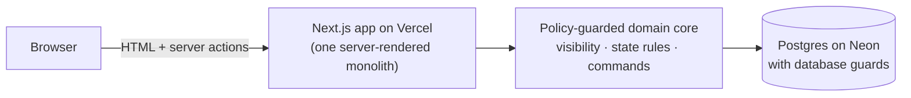

# Architecture Explainer: Requirements Interpretation Alignment

*A portfolio companion to [ARCHITECTURE-SPINE.md](ARCHITECTURE-SPINE.md). It describes the **planned** architecture. Nothing here has been implemented or tested yet, so no claim is made that security, privacy, accessibility, performance or scalability has been verified. Those claims can only follow implementation and the test plan below.*

## What the product does, in one paragraph

Before refinement, Product, Development and QA each answer a few concrete questions about a user story **without seeing each other's answers**. The facilitator reveals each question when ready. The team decides whether the answers describe the same behaviour, and either records a final decision (with the decision owner as reported) or leaves the item open with a named owner. The core promise is that **nobody sees anyone else's hidden answer, or even whether it was a real answer or a "Can't answer", before reveal**. Most of the architecture exists to keep that promise.

## The shape

**One application, no microservices.** It is a solo-built MVP, so one cohesive codebase is easier to build, test and explain.

## Key decisions and why

| Decision | Why | Trade-off accepted |
|---|---|---|
| **Next.js 16 + TypeScript, server-rendered, on Vercel** | A mature stack in the author's language. Pages are built on the server, so hidden data never needs to reach the browser. Deploys from git. | Next.js's default caching and prefetching must be **switched off** for session pages, so data from one role can't be replayed for another. |
| **Postgres (Neon) via a standard `pg` pool** | The core rules need real multi-statement transactions and row locks. This is the connection mode Neon recommends on Vercel's Node runtime. | Free-tier limits apply. A small connection pool is managed on Vercel's runtime. |
| **One "visibility" rule that every read goes through** | Hiding answers in the UI isn't enough. The database query for other people's hidden answers reads from a view that **has no answer or answer-type columns at all**. | Every new screen must use these view models, never raw rows. Enforced by project structure and tests. |
| **Every change is a transaction with re-checks, in a fixed order** | Prevents races such as a reveal and a last-second submission. Permissions and state are re-checked after locking, and checks never reveal hidden information through error messages or counts. | Slightly more code per action, in exchange for predictable behaviour. |
| **Rules duplicated as database guards** | "Revealed questions can't be answered" and "final resolutions can't change" hold even if application code has a bug. | Triggers add complexity. A single, narrowly guarded function is the only way the demo can delete its own data. |
| **Private role links instead of accounts** | No sign-up or email: the facilitator shares one link per perspective. The secret sits in the link's URL path. Opening it sets a secure cookie and redirects, so the address bar no longer shows it. Only a hash is stored. The link itself stays valid and can be reused (from browser history, the sharing channel or the host's request logs) until revoked. | **A link is a bearer credential.** Whoever holds it acts as that role. The facilitator sees every link at creation. Lost links can't be recovered, so the session is recreated. Privacy holds **per link, not per person**. |
| **A per-visitor fictional demo** | A portfolio reviewer can try the whole workflow alone, switching between fictional people, without affecting anyone else. | Demo copies are cleaned up after 24 hours. Role switching exists only in demo sessions; real sessions refuse it. |
| **First-party only** | No analytics or third-party scripts; the font is self-hosted; strict security headers. | No usage analytics, which is deliberate, given the privacy focus. |

## How privacy is meant to be enforced (planned)

1. **Who is asking?** Every request is identified from a per-session cookie on the server. Nothing the browser sends about roles is trusted.
2. **Is it their session?** Every action checks that the target belongs to the requester's session.
3. **What may they see?** A single projection gives other people only "Submitted / Not submitted" before reveal.
4. **Nothing cached:** no server, client or browser history caching of session pages.
5. **Stale tabs are rejected:** if a browser switches to another role's link, an older tab can't submit as the wrong role.

## How it will be tested (planned)

- **Canary leak tests:** unique marker text is planted in hidden answers, every page and action is called as every other role, and the test fails if the marker or any hint of the answer type appears.
- **Differential tests:** two hidden answers that differ only in type or length must produce identical pages for other viewers.
- **Concurrency tests:** simultaneous conflicting actions must have exactly one winner.
- **Database guard tests:** direct SQL attempts to break the rules must fail.
- **End-to-end and accessibility:** Playwright runs the 2–3-minute demo path and keyboard-only flows; axe-core checks the key screens against the WCAG 2.2 AA *target* (not a conformance claim).

## What it deliberately doesn't do

No accounts, invitations or organisation management; no real-time collaboration; no AI comparison; no issue-tracker integration; no analytics; no speculative scaling. These are MVP boundaries, not oversights. Several are listed as possible future directions only if real use justifies them.

## Honest status

- The product's value is **unvalidated**: no customer interviews were conducted.
- The architecture is **planned and reviewed**: an internal reconciliation, a technology check against current documentation, and an adversarial review.
- It is **not yet implemented or tested**.
