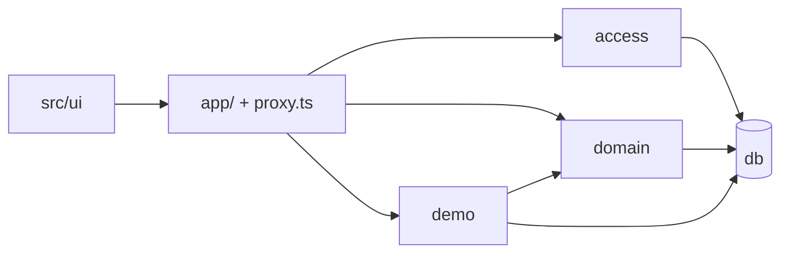
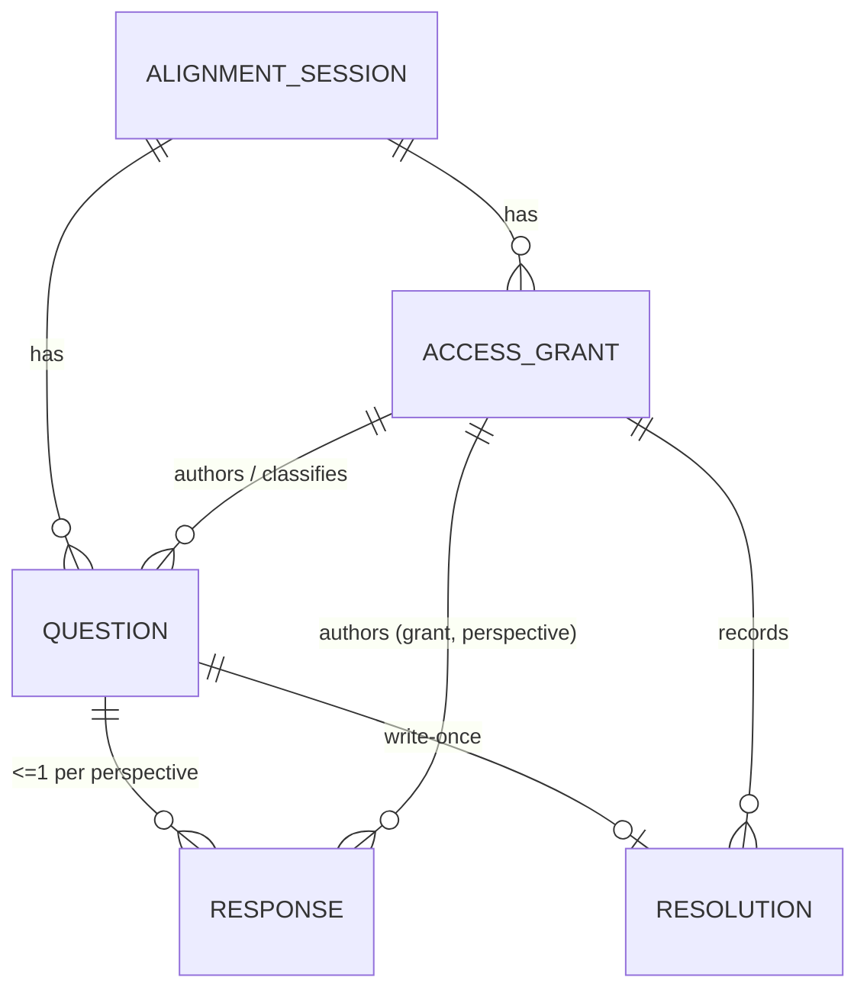
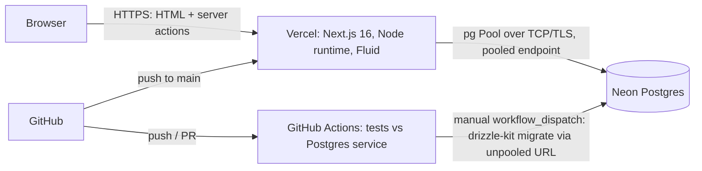

# Architecture Spine: Requirements Interpretation Alignment

PRD Glossary terms are used verbatim. Rationale and trade-offs live in `.memlog.md`, and reviews in `reviews/`. This is a **planned** architecture; nothing in it has been implemented or tested yet.

## Design Paradigm

**A server-authoritative modular monolith**: one Next.js application, with all session data read and written on the server through a **policy-guarded domain core**.

| Layer | Directory | May depend on |
|---|---|---|
| **Interface:** pages, server actions (`'use server'` only here), route handlers, `proxy.ts` | `app/`, `proxy.ts` | `access`, `domain`, `demo` (never `db`) |
| **Access:** token hashing, cookie contract, actor resolution | `src/server/access/` | `db` |
| **Domain:** commands, queries, projection, coverage, errors | `src/server/domain/` | `db` |
| **Demo:** fixture, create, reset, switch, cleanup | `src/server/demo/` | `domain`, `db` (returns grant ids; never writes cookies) |
| **Persistence:** schema, migrations (incl. SQL views, functions, triggers), repositories | `src/server/db/` | — |
| **UI components** (presentational; consume projection types only) | `src/ui/` | none of `src/server/*` |



## Invariants & Rules

### AD-1 — Every interface resolves an Actor, then calls the domain [ADOPTED]
- **Binds:** FR-3, FR-10, FR-11, NFR-1
- **Prevents:** a route, action or handler reading session data without authorisation, or trusting a client-supplied role.
- **Rule:**
  - Every page, server action and route handler calls `resolveActor(sessionId)`, then calls only domain commands or queries.
    - `sessionId` comes from the route segment, or from the target row on the server.
    - The function reads only that session's cookie (AD-17) → active grant → `Actor { grantId, sessionId, isFacilitator, perspective | null, isDemo, displayName }`.
  - `app/` never imports `db`.
  - No role, perspective, grant id or response id from the client is trusted for authorisation.
  - **Uniform denial:** an unknown session, an invalid or missing cookie, a revoked grant, an unknown or demo token, and a session mismatch all return the same "You don't have access to this alignment session." response, with no session details and identical status code.
  - Every exposed interface is listed in `src/server/interfaces.ts` (AD-21).

### AD-2 — Access grants are bearer role links [ADOPTED]
- **Binds:** FR-1, FR-2, FR-3
- **Prevents:** token leakage, identity overclaims, and drift between grant and perspective.
- **Rule:**
  - **Tokens:** 256-bit random; **only the SHA-256 hash is stored**. Normal grants only; **demo grants have no token** (AD-9).
  - **Where the token appears.** The token is part of the **access link's URL path** (`{APP_ORIGIN}/access/{token}`). This is the only URL that ever contains it. It is therefore present:
    1. on the facilitator's one-time setup screen;
    2. wherever the facilitator shares the link;
    3. in the recipient's address bar, briefly, until the redirect;
    4. in browser history;
    5. in Vercel platform request logs.
  - **Exchange.** `GET /access/{token}` → look up an active, non-demo grant by hash → set the credential cookie (AD-17) → `303` to `/s/{sessionId}`, so the address bar no longer shows the token after the redirect. The response sends `Referrer-Policy: no-referrer`, `Cache-Control: no-store` and `X-Robots-Tag: noindex`, with no link-preview metadata.
  - **What the exchange does not do.** It does **not** consume or rotate the token: the link stays valid and reusable until its grant is revoked (AD-16). Anyone who later obtains the link from history, logs or the sharing channel can use it.
  - **The application never places a token** in any other URL (session URLs, query strings, fragments), in web storage, in its own logs, or in analytics.
  - **One-time display:**
    - Tokens are returned **only** in the response of the issuing command (`createSession`, or `assignPerspective` per AD-16) to the facilitator's browser, rendered on the setup screen with the warning "These access links are shown only once. Save them now. If lost, they cannot be recovered."
    - `createSession` also sets the facilitator's own cookie and **does not redirect**.
    - Links are built from the configured `APP_ORIGIN`.
    - Apart from the access link itself, tokens never appear in a URL, a query string, a fragment or web storage. The application never logs them or sends them to analytics (there is none), never caches them (`no-store`), and cannot retrieve them later.
  - **A lost link means recreating the session** (accepted MVP limitation). Re-issuing a lost link and storing encrypted secrets are deferred.
  - **Uniqueness:** unique `(session_id, perspective)` among **active** (non-revoked) grants; exactly one active facilitator grant per session. A facilitator who holds a perspective has **one combined grant**.
  - **Identity limitation (documented):** a grant proves possession of a link, not a distinct human. One person holding two links cannot be detected. **The facilitator receives every participant's link at issuance, so they could act as any participant.** Privacy guarantees (FR-10, FR-11) therefore hold **per credential, not per person**.
  - **Residual exposure (documented):**
    - The link stays in the recipient's browser history and in the channel it was shared through.
    - Vercel platform request logs, visible only to the project owner, record `/access/*` paths.
    - Chat link previews may fetch the link.
    - A cross-site `GET /access/{token}` could place a victim's browser into an attacker's own grant for the attacker's own session. That's low impact, because cookies are per session.

### AD-3 — Visibility is a single server-side projection [ADOPTED]
- **Binds:** FR-8, FR-10, FR-11, FR-12, FR-14, FR-20, FR-22
- **Prevents:** hidden response content or response type reaching an unauthorised actor through any payload, page, summary, copy text, error or count.
- **Rule:**
  - All reads of responses go through `domain/visibility.ts`.
  - For a **Hidden** question, a non-author actor receives only `{ perspective, submitted: boolean }`. This is read from the `response_status` SQL view (question id, perspective, submitted), which **has no content or type columns**. The author receives their own full response.
  - For a **Revealed** question, everyone with a role receives all submitted responses. These come from a revealed-only SQL view joined on `question.state = 'revealed'`.
  - The decision summary and both copy formats are rendered from the projection (AD-20).
  - Page titles and metadata use only story and question text.

### AD-4 — No caching or prefetching of session data [ADOPTED]
- **Binds:** FR-10, FR-11, FR-22, NFR-1
- **Prevents:** a cached, prefetched or history-restored payload from one actor being shown to another, including after a demo role switch.
- **Rule:**
  - `next.config`: `cacheComponents: false`, and Partial Prefetching disabled.
  - Session routes use `export const dynamic = 'force-dynamic'`.
  - Links to session routes use `prefetch={false}`.
  - `'use cache'`, `unstable_cache` and `force-cache` are banned by lint across `app/` and `src/server/`.
  - Responses send `Cache-Control: private, no-store`, which also disables the browser back/forward cache in most browsers. An end-to-end test asserts the actual header.
  - Mutations call `refresh()` (or `revalidatePath`) for a server re-render. There is no client-side store of session data.
  - A demo role switch and a reset navigate with `location.replace` (full load, no history entry).
  - A test asserts that no previous actor's data appears after a switch followed by client navigation and back/forward.

### AD-5 — Mutations are transactional domain commands with re-checks [ADOPTED]
- **Binds:** FR-1–FR-19, FR-23, FR-24
- **Prevents:** races, and permission checks made against stale state.
- **Rule:** each command runs in **one database transaction**:
  1. begin;
  2. acquire locks in the AD-18 order;
  3. re-resolve the actor's active grant inside the transaction;
  4. run the checks in the AD-15 order;
  5. write with conditional statements (requiring 1 affected row);
  6. commit.

  Commands accept only ids of rows in the actor's session plus user-entered text. They never accept a grant id, perspective or response id for authorisation.

  A failure returns a typed `DomainError`: `NO_ACCESS`, `NOT_FOUND`, `NOT_FACILITATOR`, `NOT_AUTHOR`, `STALE_ROLE`, `STALE_QUESTION`, `QUESTION_REVEALED`, `QUESTION_HIDDEN`, `HAS_RESPONSES`, `INSUFFICIENT_EVIDENCE`, `ALREADY_RESOLVED`, `PERSPECTIVE_TAKEN`, `DUPLICATE_PERSON`, `NOT_DEMO`. The UI maps each code to the EXPERIENCE.md copy.

  **Stale-view checks:** `classifyQuestion` and `setFollowUpOwner` carry the classification and follow-up owner the user saw. A mismatch returns `STALE_QUESTION`, so a second tab can't silently clear an owner the user never saw.

  Commands: `createSession`, `assignPerspective`, `addQuestion`, `editQuestion`, `removeQuestion`, `submitResponse`, `revealQuestion`, `classifyQuestion`, `setFollowUpOwner`, `recordResolution`, `createDemo`, `resetDemo`, `switchDemoActor`.

### AD-6 — State-machine guards also live in the database [ADOPTED]
- **Binds:** FR-2, FR-6, FR-7, FR-9, FR-12, FR-13, FR-15, FR-16
- **Prevents:** a bug, script or new code path bypassing the application rules.
- **Rule:** triggers and constraints (custom SQL migrations) enforce:
  - `question.state ∈ {hidden, revealed}`, with no change from revealed back to hidden;
  - no `response` insert or update once the question is revealed;
  - no question text update once any response exists or the question is revealed;
  - a classification other than `not_yet_reviewed` requires `state = 'revealed'`, and there is no change back to `not_yet_reviewed`;
  - no grant replacement or perspective change once that perspective has a response in the session;
  - `alignment_session.is_demo` cannot change after insert.

  **Deletion rules:**
  - **Question:** delete only while Hidden with no responses, or through the demo path (AD-19).
  - **Response and resolution:** delete only through the demo path (AD-19).

### AD-7 — Resolutions are write-once records [ADOPTED]
- **Binds:** FR-16, FR-17, FR-19
- **Prevents:** a recorded decision being edited, deleted, reopened, or invalidated by a reclassification.
- **Rule:**
  - A separate `resolution` table, unique on `question_id`. A trigger rejects `UPDATE`, and allows `DELETE` only via AD-19.
  - Inserting a resolution requires the question to be revealed **and** classified Conflict or Unanswered.
  - The resolution snapshots `decision_owner_name`, `decision_owner_role` (required, no defaults, never pre-filled with the facilitator), `recorded_by_grant_id` and `recorded_by_name`.
  - A trigger rejects changes to `question.classification` or `question.follow_up_owner` once a resolution exists.

### AD-8 — Classification, coverage and follow-up semantics [ADOPTED]
- **Binds:** FR-14–FR-18, FR-20
- **Prevents:** confusing coverage with substantive count, automatic classification, and inconsistent follow-up handling.
- **Rule:**
  - `classification ∈ {not_yet_reviewed, aligned, conflict, unanswered}`, with `classified_by_grant_id` stored.
  - Aligned and Conflict require at least 2 revealed responses of type `answer`, counted inside the transaction **after** the revealed-state check (AD-15).
  - **Resolution status is derived, never stored:**
    - a resolution row exists → Resolved;
    - Conflict or Unanswered without a resolution → Open;
    - otherwise none.
  - `follow_up_owner` is free text on `question`. It can be set only while the question is Conflict or Unanswered with no resolution. It is cleared only by an unresolved Conflict/Unanswered → Aligned change; Conflict ↔ Unanswered keeps it.
  - Counts come only from `domain/coverage.ts`, operating on projection output (AD-20). `submitted` counts all responses; `substantive` counts type `answer`. **Neither is stored.**
  - The application never classifies automatically.

### AD-9 — The demo is per-visitor, flagged and self-cleaning [ADOPTED]
- **Binds:** FR-21–FR-24, NFR-3
- **Prevents:** shared demo state between visitors, impersonation in normal sessions, demo actions touching real sessions, and fixture secrets in the repository.
- **Rule:**
  - **Create (`POST /demo` only, never on GET):**
    - If the visitor's `demo_owner` cookie matches a live demo, it is reused.
    - Otherwise, a new `alignment_session` with `is_demo = true` is cloned in one transaction from the **versioned, code-defined fixture** matching the FR-23 starting state, with a random owner key stored **hashed**.
  - **Demo grants** have **no tokens**; `/access` rejects them.
  - **`switchDemoActor`:**
    - succeeds only if the session is a demo and the visitor's owner key matches;
    - targets another grant of the **same** demo session;
    - returns a grant id, which the interface layer writes into the cookie (AD-17), then navigates with `location.replace`;
    - for any normal session, returns `NOT_DEMO`.
  - **`resetDemo`:** deletes the demo via AD-19, re-clones it as a **new session id**, points the cookie at the clone's facilitator grant (Maya), and does a full navigation to the new URL.
  - **Cleanup:** on each `createDemo`, demo sessions older than 24h are deleted via AD-19, taking each session's lock.
  - The demo banner renders if and only if `session.is_demo`.

### AD-10 — No deletion of normal sessions or responses [ADOPTED]
- **Binds:** FR-8, FR-17, PRD §6.2
- **Prevents:** any path that removes recorded responses or resolutions.
- **Rule:** there is no delete command for normal sessions and no withdraw command for responses. The only session deletion is AD-19.

### AD-11 — Minimal, first-party web surface [ADOPTED]
- **Binds:** NFR-1, NFR-3, NFR-4
- **Prevents:** token or data leakage via third parties, and script injection.
- **Rule:**
  - No third-party scripts, analytics or font CDNs. Inter is served via `next/font`, self-hosted with no runtime request to Google.
  - A **nonce-based CSP** is set in `proxy.ts` (`script-src 'self' 'nonce-…' 'strict-dynamic'`, `frame-ancestors 'none'`), checked against the Next.js CSP guide at scaffold, with a header test.
  - `Referrer-Policy: no-referrer` on `/access/*`; `strict-origin-when-cross-origin` elsewhere.
  - Application logs never include request bodies, tokens or response content. Vercel platform path logging is documented in AD-2.

### AD-12 — Test strategy guards the invariants [ADOPTED]
- **Binds:** NFR-1, NFR-2, NFR-4
- **Prevents:** regressions in privacy, irreversibility and isolation passing silently.
- **Rule:**
  1. **Domain unit tests:** state rules, coverage, minimum evidence, check order.
  2. **Integration tests against real PostgreSQL:** every command's success and failure paths, including cross-session attempts (`NO_ACCESS`); and **database guard tests**, where direct SQL attempts are rejected, including demo-path deletion only.
  3. **Canary leak test:** seeds unique canary strings as hidden content and as reasons for Can't answer, then calls **every registry interface as every non-author actor**, in normal and demo sessions, before reveal. It fails on any canary or response-type indicator in any payload, error or copied text.
  4. **Differential leak test:** two fixtures differing only in a hidden response's type, content and length must render byte-identical output for each non-author actor.
  5. **Concurrency tests:** reveal ∥ submit, reveal ∥ edit, remove ∥ submit, reassign ∥ submit, double `recordResolution`, classify ∥ resolve, reset ∥ action. Exactly one outcome must win.
  6. **Playwright end-to-end:** the UJ-2 demo path; keyboard-only runs; switch → client navigation → back/forward shows no previous-actor data; header assertions.
  7. **axe-core checks** on S3, S3a, S4 and the dialogs.
  8. **CI:** GitHub Actions with a PostgreSQL service container, running on every push and PR. Migrations are applied before tests.

### AD-13 — The active credential decides; stale tabs are rejected [ADOPTED]
- **Binds:** FR-3, FR-8–FR-19, FR-22, FR-24
- **Prevents:** a tab rendered for one role submitting after the browser's credential changed to another role.
- **Rule:**
  - Opening another role link for the same session **replaces** that session's cookie (AD-17), so one browser holds one role per session.
  - Every request and server action derives the actor from the **active cookie** on the server, re-resolved inside the transaction.
  - Every mutation form carries the rendered `expected_grant_id`, used **only as a consistency check**. A mismatch returns `STALE_ROLE`: "Your access in this browser has changed. Reload to continue." The demo switch uses the same check.

### AD-14 — Database connection mode [ADOPTED]
- **Binds:** AD-5, AD-6, AD-7, NFR-5
- **Prevents:** using a driver or connection mode that cannot hold an interactive transaction or a row lock in the deployed runtime.
- **Rule:**
  - Drizzle's **node-postgres** adapter over a `pg` **Pool** created once in module scope and registered with `attachDatabasePool` (`@vercel/functions`).
  - Runs on the Vercel **Node.js runtime with Fluid compute** (the default for new projects). The Edge runtime is not used.
  - The app uses Neon's **pooled** connection string (PgBouncer transaction mode). Transactions and `SELECT … FOR UPDATE` happen only inside one transaction.
  - No session-level state: no `SET` outside a transaction (only `SET LOCAL`), no session advisory locks, no SQL-level `PREPARE`, no `LISTEN`. Protocol-level prepared statements are permitted.
  - Migrations use the **direct** (unpooled) connection string. Local development and CI use the same driver against standard PostgreSQL.

### AD-15 — Session scoping and mandatory check order [ADOPTED]
- **Binds:** FR-3, FR-6–FR-19, NFR-1
- **Prevents:** acting on another session's rows, and content-dependent results (e.g. evidence counts) revealing hidden response types.
- **Rule:** every command checks in this order, and stops at the first failure:
  1. actor authorised for the command (facilitator or author as required);
  2. **target row's `session_id = actor.sessionId`**, otherwise `NO_ACCESS`;
  3. state preconditions (e.g. Revealed for classification or resolution, Hidden for editing);
  4. only then, content-dependent checks (evidence counts, response existence).

  No error message or code before step 4 depends on hidden response content or type.

### AD-16 — Access grant lifecycle [ADOPTED]
- **Binds:** FR-2, FR-3, FR-8
- **Prevents:** a replaced participant's link still working, and responses becoming detached from their perspective.
- **Rule:**
  - An unassigned perspective has **no grant row**, and its responses display as Not submitted.
  - `assignPerspective` (facilitator only) issues a **new token shown once** (AD-2 rules) for a perspective that has no response in the session. Replacing an existing assignee sets `revoked_at` on the old grant, and revoked grants fail AD-1 uniformly.
  - Once a perspective has any response, its grant cannot be replaced (AD-6).
  - Display names are required and unique per session (case-insensitive). A duplicate returns `DUPLICATE_PERSON`.
  - Responses carry `perspective` and `author_grant_id`, with a composite FK `(author_grant_id, perspective)` and `unique(question_id, perspective)`.
  - **Note:** re-assigning before any response also issues a fresh link. That is assignment, not the deferred lost-link recovery feature.

### AD-17 — Credential cookie contract [ADOPTED]
- **Binds:** FR-3, AD-1, AD-9, AD-13
- **Prevents:** two units writing incompatible cookies, and credentials leaking across sessions.
- **Rule:**
  - Cookie name `rg_<sessionId>`, with `Path=/s/<sessionId>`, HttpOnly, Secure, `SameSite=Lax`, `Max-Age` 30 days.
  - Its value is an HMAC (keyed by `SESSION_SECRET`) of `{grantId, sessionId}`.
  - **Only `src/server/access/cookie.ts` reads or writes it.** Demo code returns grant ids; the interface layer writes the cookie.
  - The demo owner uses a separate `demo_owner` cookie with the same flags.
  - If cookies are cleared, access is lost; it is regained only by reopening the original link (normal sessions) or opening a new demo.

### AD-18 — Lock order [ADOPTED]
- **Binds:** AD-5, AD-9, AD-16
- **Prevents:** deadlocks, and races between session-level and question-level commands.
- **Rule:**
  1. lock the **session row** first: exclusive (`FOR UPDATE`) for session-level commands (assign, add question with numbering, reset, cleanup), shared (`FOR SHARE`) for question-level commands;
  2. then the **question row** (`FOR UPDATE`);
  3. then read the grant.

  No command locks in any other order.

### AD-19 — The only deletion path is the demo function [ADOPTED]
- **Binds:** AD-6, AD-7, AD-9, AD-10
- **Prevents:** database guards blocking demo reset and cleanup, and any normal-session data being deleted.
- **Rule:**
  - A SQL function `delete_demo_session(id)` verifies `is_demo = true`, sets `SET LOCAL app.demo_delete = <id>`, and deletes the session (cascade).
  - The delete-guard triggers on question, response, resolution and grant allow a delete only when that setting equals the row's session id, or (for questions) when the Hidden-with-no-responses rule holds.
  - `is_demo` is immutable (AD-6).

### AD-20 — Only projection types reach the UI [ADOPTED]
- **Binds:** FR-10, FR-11, FR-14, FR-20, NFR-1
- **Prevents:** raw rows, or counts derived from them, leaking hidden response types into payloads.
- **Rule:**
  - `visibility.ts` returns typed view models. The **Hidden-question view type has no content, type or substantive-count field.**
  - `coverage.ts` computes only from these view models.
  - `src/ui` and `app/` may only consume view-model types; repository row types are not exported outside `src/server/`.

### AD-21 — Interface registry completeness [ADOPTED]
- **Binds:** AD-1, AD-12, NFR-1
- **Prevents:** an unregistered route or server action escaping authorisation review and the leak tests.
- **Rule:**
  - `'use server'` modules live only in `app/`.
  - A CI test fails if any page, route handler or exported server action is missing from `src/server/interfaces.ts`, or any registry entry no longer exists.

## Consistency Conventions

| Concern | Convention |
| --- | --- |
| Naming | snake_case singular tables (`alignment_session`, `access_grant`, `question`, `response`, `resolution`). TypeScript types: PascalCase, mirroring the PRD Glossary. Commands: verbNoun. |
| Core columns | **alignment_session:** id, story_title, story_description, is_demo, demo_owner_key_hash, created_at. **access_grant:** id, session_id, display_name, is_facilitator, perspective (nullable), token_hash (nullable for demo), revoked_at. **question:** id, session_id, number (per-session sequence, assigned under the session lock), text, author_grant_id, is_follow_up (true if any question in the session was already revealed at creation), state, revealed_at, classification, classified_by_grant_id, follow_up_owner. **response:** id, question_id, perspective, author_grant_id, type, content, reason, updated_at. **resolution:** question_id (PK), statement, decision_owner_name, decision_owner_role, recorded_by_grant_id, recorded_by_name, created_at. |
| IDs | UUIDv7. Session URLs use the session UUID. Tokens are separate and never appear in a session URL. |
| Dates | `timestamptz` UTC; rendered in the user's locale. |
| Enums | `question_state`, `classification`, `response_type` (`answer` · `cant_answer`), `perspective` (`product` · `development` · `qa`). |
| Errors | `{ ok: true, … }` or `{ ok: false, code }` (AD-5). No raw database errors reach the UI. |
| UI state across re-renders | The open review panel is kept in the URL (`?review=<questionId>`). Command results return a focus target and an announcement string (EXPERIENCE.md). The "Now acting as …" message after a demo switch passes through a one-shot HttpOnly flash cookie. |
| Styling | CSS Modules plus global CSS custom properties generated from the DESIGN.md tokens; inline SVG icons committed to the repo. No UI framework. |
| Config and secrets | `DATABASE_URL` (pooled), `DATABASE_URL_UNPOOLED` (migrations), `SESSION_SECRET`, `APP_ORIGIN`. Stored in Vercel project environment variables. CI uses its own service-container database and needs no production secrets. |
| Logging | Vercel runtime logs only; no request bodies, tokens or response content. |

## Stack

| Name | Version |
| --- | --- |
| Node.js | 22 LTS or newer (Next.js 16.4 requires ≥ 20.9) |
| TypeScript | the version `create-next-app@16.4.x` installs (7.0.x current; confirm typescript-eslint support) |
| Next.js (App Router, Node runtime, `cacheComponents: false`) | 16.4.x (16.4.6 current on 2026-11-09) |
| Drizzle ORM / drizzle-kit (`node-postgres` adapter) | 0.45.x / 0.31.x, unless 1.0 is GA at scaffold |
| `pg` + `@vercel/functions` (`attachDatabasePool`) | current; `@vercel/functions` 3.x |
| PostgreSQL | Neon-managed default major; the same major in the CI service container |
| Vitest | 5.x |
| Playwright / @axe-core/playwright | 1.65.x / 4.14.x |
| Inter | `next/font` (self-hosted at build) |
| Hosting | Vercel Hobby (Fluid compute) + Neon Free, subject to the limits current at deploy time |
| Dependency updates | Dependabot or Renovate on the repository |

## Structural Seed





**Environments and deployment:**
- **local:** local Postgres or a Neon branch.
- **CI:** GitHub Actions with a Postgres service container; runs all tests on every push and PR.
- **production:** Vercel + Neon main branch.
- **Migrations** (amended 2026-11-10 at Story 1.1, by user instruction) run through a **controlled, single-run step**: a manually triggered GitHub Actions `workflow_dispatch` job, or the equivalent local `npm run db:migrate:prod`, using the unpooled URL stored as a repository secret. They are **not** run automatically in Vercel builds, so preview and production builds never migrate the database. They are run before merging changes that depend on them, and must be backward compatible with the previous deployment. Branch protection requires CI to pass before merging to `main`.

```text
app/                 # / (S1), /new (S2 + one-time links), /s/[sessionId] (S3, S3a via ?review=), /s/[sessionId]/summary (S4), /access/[token], /demo (POST)
proxy.ts             # nonce CSP + security headers
src/server/access/   # token hash, cookie.ts (sole cookie owner), resolveActor
src/server/domain/   # commands, queries, visibility.ts, coverage.ts, errors.ts
src/server/demo/     # fixture (tokenless grants), createDemo, resetDemo, switchDemoActor, cleanup
src/server/db/       # drizzle schema, migrations (custom SQL: views, delete_demo_session, triggers), repositories
src/server/interfaces.ts  # interface registry (AD-21)
src/ui/              # CSS Modules components per DESIGN.md, inline SVG icons
tests/               # unit, integration, db-guards, leak (canary + differential), concurrency, e2e, a11y
```

## Capability → Architecture Map

| Capability / Area | Lives in | Governed by |
| --- | --- | --- |
| FR-1–FR-3 Setup and access | `app/new`, `app/access`, `access/*`, `createSession`, `assignPerspective` | AD-1, AD-2, AD-5, AD-13, AD-16, AD-17 |
| FR-4–FR-7 Questions | `addQuestion`, `editQuestion`, `removeQuestion` | AD-5, AD-6, AD-15, AD-18 |
| FR-8–FR-11 Responses and privacy | `submitResponse`, `visibility.ts` | AD-3, AD-4, AD-6, AD-15, AD-20 |
| FR-12–FR-14 Reveal, lock, coverage | `revealQuestion`, `coverage.ts` | AD-5, AD-6, AD-8, AD-20 |
| FR-15–FR-19 Classification and resolution | `classifyQuestion`, `setFollowUpOwner`, `recordResolution` | AD-5, AD-7, AD-8, AD-15 |
| FR-20 Decision summary | `app/s/[sessionId]/summary` | AD-3, AD-4, AD-20 |
| FR-21–FR-24 Demo | `app/demo`, `src/server/demo` | AD-4, AD-9, AD-17, AD-19 |
| NFR-1, NFR-2 Privacy and tests | `tests/`, `interfaces.ts` | AD-1, AD-12, AD-21 |
| NFR-4 Accessibility | `src/ui`, e2e/axe | AD-12, DESIGN.md / EXPERIENCE.md |

## Deferred

- **Rate limiting, and a global cap on demo sessions.** Tokens are unguessable, demo visitors reuse their own demo, and 24h cleanup bounds growth. Revisit if storage nears the Neon free limit or abuse appears.
- **Link re-issuance for lost links, and encrypted secret storage.** Deferred by decision.
- **Observability beyond Vercel logs; backups beyond what the Neon free plan provides.** Low-stakes MVP.
- **Preview environments with per-branch databases; performance budgets; scaling.** Not needed.
- **UX addendum: done 2026-11-10.** EXPERIENCE.md now defines the S2 Access links panel and the S3 Assign/Replace dialog (one-time display, revocation notice). The PRD addendum §E records the bearer-link trade-off.
